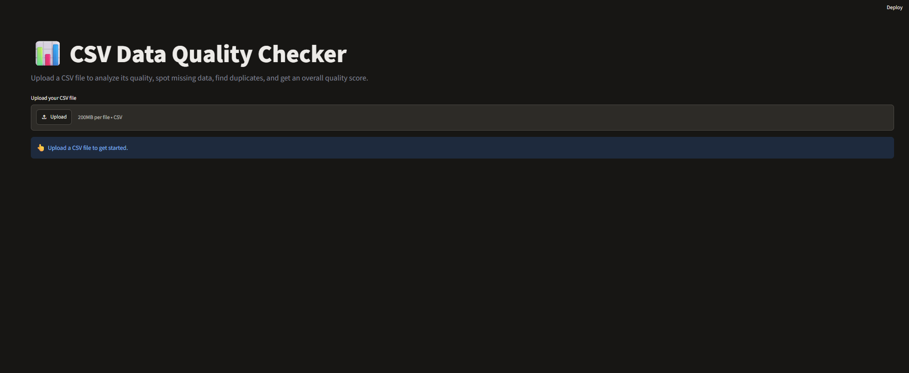
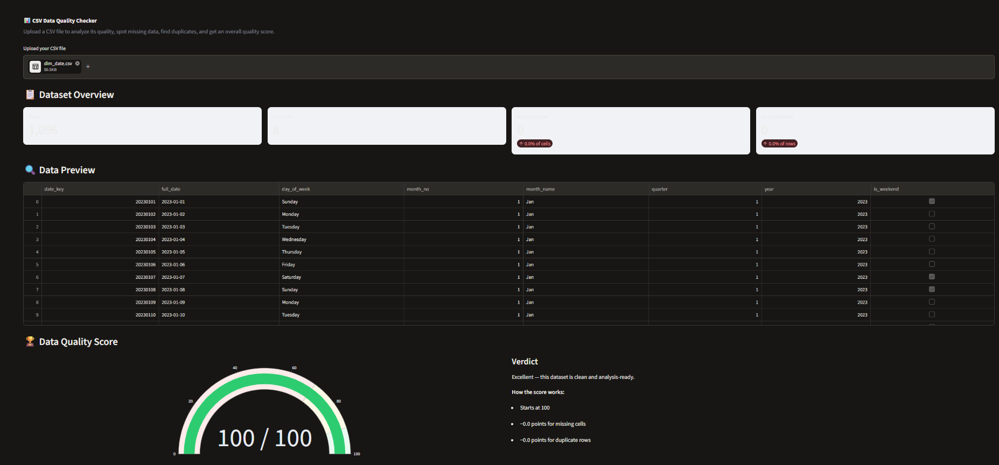

# 📊 CSV Data Quality Checker

[](https://www.python.org/)
[](https://streamlit.io/)
[](https://pandas.pydata.org/)
[](https://plotly.com/python/)

A **Streamlit** web application that analyzes any CSV file for data quality issues — missing values, duplicate rows, and column-level problems — and summarizes everything into a single **Data Quality Score** with interactive **Plotly** visualizations.

Built as a data engineering / data analytics portfolio project.

## 🚀 Live Demo

[Open the CSV Data Quality Checker](https://csv-data-quality-checker-fx9ysbdm9zynsh6m2yzurj.streamlit.app/)

## ✨ Features

- **📁 CSV Upload** — drag and drop any CSV file
- **📋 Dataset Overview** — row count, column count, missing values, and duplicate rows at a glance
- **🏆 Data Quality Score** — starts at 100 and loses points for missing data and duplicates, displayed on a color-coded gauge (green / yellow / red) with a plain-English verdict
- **📈 Interactive Visualizations** —
  - Missing values by column (bar chart)
  - Column data type breakdown (donut chart)
  - Numeric column distributions (histogram)
- **🧾 Column Details Table** — per-column data type, missing %, and unique value counts
- **🔍 Data Preview** — first 50 rows of the uploaded dataset

## 🖼️ App Preview

Start by uploading a CSV file:



After upload, review the dataset summary, preview, and quality score:



## 🛠️ Tech Stack

| Tool | Purpose |
|------|---------|
| [Python](https://www.python.org/) | Core language |
| [Streamlit](https://streamlit.io/) | Web app framework |
| [Pandas](https://pandas.pydata.org/) | Data loading and analysis |
| [Plotly](https://plotly.com/python/) | Interactive charts |

## 🚀 Getting Started

### Prerequisites

- Python 3.9 or newer installed
- Git installed

### 1. Clone the repository

```bash
git clone https://github.com/MaxKarltun/csv-data-quality-checker.git
cd csv-data-quality-checker
```

### 2. Create and activate a virtual environment

**Windows (PowerShell):**

```powershell
python -m venv venv
.\venv\Scripts\Activate.ps1
```

**macOS / Linux:**

```bash
python3 -m venv venv
source venv/bin/activate
```

### 3. Install dependencies

```bash
pip install -r requirements.txt
```

### 4. Run the app

```bash
streamlit run app.py
```

The app opens automatically in your browser at **http://localhost:8501**. Upload a CSV file and explore your data quality report!

To stop the app, press **Ctrl+C** in the terminal.

## 📐 How the Quality Score Works

```
Score = 100 − (% of missing cells) − (% of duplicate rows)
```

| Score | Verdict |
|-------|---------|
| 90–100 | 🟢 Excellent — clean and analysis-ready |
| 70–89 | 🟡 Good — minor cleanup recommended |
| 0–69 | 🔴 Needs attention — significant cleaning required |

## 👤 Author

**Max Karltun** — IT -  Data Engineering.
